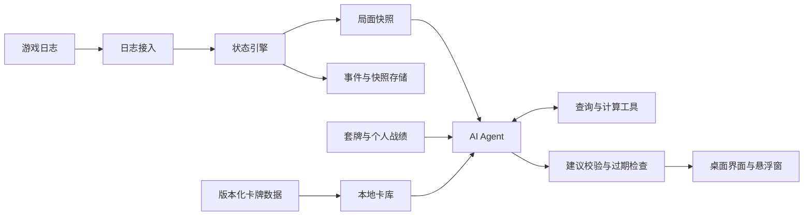

# 第一版功能与技术设计

更新日期：2026 年 10 月 29 日。

第一版为 Windows 国服标准天梯提供中文卡库、套牌管理、实时记牌和 AI 教练功能，以猎人为主要使用场景。程序从本地日志还原局面，使用计算工具核算已支持的方案，再由 Agent 提供简短建议和赛后解释。

## 第一版功能范围

| 模块 | 第一版功能 | 完成后的使用体验 |
| --- | --- | --- |
| 卡库 | 版本化中文卡牌、图片缓存、搜索、标准可用性、关联衍生牌 | 查询新卡，查看当前版本效果与适用卡池 |
| 套牌 | 导入和导出牌码、费用曲线、合法性检查、套牌版本 | 导入猎人套牌并保存每次调整 |
| 赛前 | 套牌获胜方式、关键配合、对局笔记 | 理解这套牌如何取得优势 |
| 留牌 | 结合套牌、对手职业、先后手和实际起手给建议 | 清楚知道留哪张以及理由 |
| 实时记牌 | 手牌、场面、剩余牌、已知洗入牌、对手已出牌 | 查看可靠的当前状态和已知信息 |
| 赛中 Agent | 稳定决策点的主方案、备选方案、简短依据和风险 | 迅速理解当前回合的选择 |
| 赛后 | 战绩、事件时间线、回合快照、关键决策分析 | 回到当时局面比较其他打法 |
| 个人统计 | 按补丁、套牌版本、对手职业、先后手统计并展示样本量 | 根据自己的记录调整打法和套牌 |

最新卡库与全网天梯胜率使用不同的数据来源。第一版支持导入套牌和统计个人对局；环境套牌与全网胜率接入另行评估数据来源。个人藏牌信息可在后续增加导入能力。

## 总体架构

| 模块 | 职责 |
| --- | --- |
| 日志接入 | 定位游戏、检查日志配置、增量读取、处理日志轮换和会话切换 |
| 状态引擎 | 解析事件、跟踪实体、识别玩家视角、还原局面、生成不可变快照 |
| 卡库与计算 | 管理版本数据、套牌规则、抽牌概率和已支持的牌效计算 |
| Agent | 组织模型上下文、调度工具、比较方案、生成结构化建议 |
| 存储 | 保存套牌版本、事件、快照、战绩、建议及分析依据 |
| 桌面界面 | 主窗口、实时悬浮窗、快捷提问、卡牌详情和复盘 |

第一版采用 C#、.NET 10、WPF 和 SQLite，在桌面进程中运行状态服务与 Agent 调度，通过可配置 API 调用模型。.NET 10 当前属于 LTS 版本，见[微软支持说明](https://dotnet.microsoft.com/en-us/platform/support/policy/dotnet-core)。

套牌编解码和枚举可以评估使用 [HearthDb](https://github.com/HearthSim/HearthDb)。卡牌版本由独立同步模块管理，避免应用依赖包内嵌的数据决定当前卡库版本。

## 卡库与标准卡池

[HearthstoneJSON](https://hearthstonejson.com/) 按客户端构建版本和语言提供数据，适合作为卡牌数据源。底层保存全职业数据，界面默认展示猎人和当前可用于其套牌的卡，同时保留对手卡牌和关联衍生牌的查询能力。

每份数据记录来源、构建版本、语言、获取时间和校验结果。中文显示与内部标识分开存储，保留 CardId 和 dbfId 之间的映射。

更新过程为下载、校验、暂存、切换活动版本。同步失败时继续使用已有完整缓存。对局开始后固定该局使用的数据版本，避免分析过程中更新卡牌效果。

标准可用性由版本化的卡池规则管理，结合核心系列调整、上线时间和临时禁用等信息。已经进入客户端数据的卡仍需区分已公布、已上线与当前模式可用状态。数据构建版本与当前国服客户端无法对应时，显示差异并限制依赖该版本的精确分析。

套牌检查覆盖当前模式的职业、数量、卡池和额外构筑规则。规则按版本维护，牌码中的边栏或特殊结构需要保留，无法识别时明确报出。

## 日志接入与局面还原

HearthSim 的[状态协议说明](https://hearthsim.info/docs/gamestate-protocol/)以实体、标签和区域变化描述对局。现有 HDT 的[日志接入实现](https://github.com/HearthSim/Hearthstone-Deck-Tracker/blob/master/Hearthstone%20Deck%20Tracker/LogReader/LogWatcherManager.cs)处理 Power 日志和部分选择信息，这些可作为实现参考。

当前国服客户端对动态费用、发现选项、可用动作及特殊机制的实际输出，以 M0 的真实对局验证结果为准。状态引擎根据已验证字段提供能力。

### 连接过程

1. 自动定位游戏目录，并允许手动指定；识别当前客户端版本和会话日志目录。
2. 检查日志是否开启并持续更新。需要调整日志配置时，展示变更、备份原文件，提示重启游戏使其生效。
3. 增量读取日志，处理未写完的行、文件轮换、截断、重新启动和重复事件。
4. 识别开局、双方身份、玩家视角、留牌、主要回合、选择阶段和对局结束。
5. 出现中途接入或日志缺口时，记录不完整状态；恢复能力按实际可还原的信息决定。

日志配置方式参考[HearthSim 配置说明](https://github.com/HearthSim/Hearthstone-Deck-Tracker/wiki/Setting-up-the-log.config)，具体路径和可用选项随当前安装验证。

### 事件和实体

解析器将日志转换成创建实体、公开或隐藏卡牌、变更卡牌身份、标签变化、区域变化、结算块、选择信息和会话重置等事件。状态引擎按原始顺序应用事件，保留事件序号用于回放和排查。

| 标识 | 用途 |
| --- | --- |
| CardId | 标识卡牌模板，用于查效果和版本数据 |
| dbfId | 对接牌码和卡牌数据中的数字标识 |
| EntityId | 标识本局具体实体，区分同名牌的费用、增益、位置和来源 |

实体需要保存区域、位置、控制者、可见性、已知属性和来源信息。属性缺失或会话不完整时保留未知状态；静态基础费用不能替代未确认的动态费用。

### 可见信息与推测

| 信息 | 处理方式 |
| --- | --- |
| 我方已公开手牌和场面 | 使用玩家视角下可见且可验证的身份与动态属性 |
| 对手场面和已出牌 | 保存公开身份、属性和事件 |
| 对手手牌 | 记录数量和仍可可靠追踪的公开身份，其余保留未知 |
| 对手套牌类型和可能持牌 | 作为带来源与假设的推测，与事实分开 |
| 抽牌顺序 | 仅在游戏向玩家公开且能够可靠跟踪时记录已知信息 |
| 日志中的额外身份信息 | 经玩家视角过滤后才可进入 Agent 上下文 |

当前牌库由起始套牌与实际区域变化共同维护，覆盖抽出、移出、已知洗入、变形和替换。未公开身份的变动计入未知牌，保留牌库总数与已知组成的区别。

### 局面快照

每次影响分析的状态变更递增 state_version。建议使用同一版本的不可变快照，持续到输出校验完成。等待结算块完成并应用可用的阶段信号后，再发布可分析的快照；短暂日志静默只作为辅助判据。

| 字段 | 内容 |
| --- | --- |
| match_id | 本地对局标识 |
| state_version | 单局递增的分析版本 |
| event_seq | 快照覆盖到的事件序号 |
| client_build 和 card_data_build | 客户端与卡牌数据版本 |
| format 和 region | 对局模式和地区 |
| deck_version | 这局固定使用的套牌版本 |
| phase 和 active_player | 留牌、主要回合、选择、结束等阶段及行动方 |
| me | 血量、护甲、法力、英雄技能、手牌、场面和牌库记录 |
| opponent | 玩家视角可见的对手状态及未知项 |
| recent_events | 与当前分析有关的近期事件 |
| choices | 已确认属于我方当前阶段的选择项 |
| quality | 完整性、稳定性、更新时间、数据缺口和未覆盖机制 |

## Agent 输入与工具

Agent 输入包含任务类型、当前快照、相关卡牌效果、近期事件、套牌计划和必要的对局笔记。当前快照是状态依据；对话历史用于保留问题和解释背景。

卡牌按需读取当前局涉及的版本、手牌、场面及关联衍生牌。工具调用和结果均带上局面版本，避免在一次分析中混用不同局面。

| 工具 | 主要输入 | 输出与约束 |
| --- | --- | --- |
| get_snapshot | match_id、state_version | 固定快照、完整性和未知项 |
| get_cards | CardId 列表、数据版本、语言 | 对应版本的效果、关键词和关联牌 |
| calculate_draw_odds | 快照版本、目标牌、抽取条件 | 概率、牌库依据和所需假设；组成不足时返回限制 |
| evaluate_line | 快照版本、实体与目标组成的动作序列 | 已覆盖检查、可模拟结果、假设和未支持机制 |
| evaluate_deathrattle_draw | 固定快照中的当前我方场上随从实体 | 仅已观察心中的恶魔单次亡语的直接入手、爆牌与疲劳范围；不杀死随从、不腾出手牌位、不生成新牌或证明后续动作 |
| get_matchup_plan | 套牌版本、对手职业、先后手 | 可追溯的留牌及打法笔记，缺失时明确返回 |
| get_personal_stats | 补丁、套牌版本、对手与先后手筛选 | 样本量、胜负与相关个人统计 |

工具由本地宿主执行，模型提出调用请求。第一版使用单个 Agent，通过留牌、回合建议、选择分析和复盘等任务模板复用工具。

## 从局面到建议

1. 在留牌、己方回合开始、关键选择出现或玩家快捷提问时发起分析。
2. 固定当前快照，检查完整性、卡库版本和结算状态，准备相关上下文。
3. Agent 提出候选方案，并按需调用查询与计算工具。
4. Agent 根据工具结果输出主方案、备选方案、简短依据、风险和未知项。
5. 本地检查输出结构、引用实体、已支持规则下的动作与目标，并核对当前 state_version。
6. 校验通过后展示建议；局面变化时旧建议立即失效，按最新决策点重新分析。

### 牌效计算范围

卡牌文本需要额外的规则实现才能参与可靠模拟。HearthDb 提供的卡牌数据与牌码能力，并不直接提供完整出牌模拟。

第一版围绕常用的 1 至 2 套猎人实现关键牌效，并覆盖其必要的对手交互。计算按能力拆分为基础动作检查和牌效模拟，结果说明实际覆盖的部分。完整确定性结算得到覆盖后，才对该范围内的斩杀方案标记已验证。

随机效果、奥秘、未覆盖的触发和新机制通过显式假设与范围表达。未知机制可以降低具体动作建议的验证级别；缺失关键数据时暂停依赖该数据的精确计算。

### 建议输出

| 字段 | 展示或校验用途 |
| --- | --- |
| match_id 和 state_version | 绑定本次分析依据，拒绝过期结果 |
| task_type | 区分留牌、回合、选择与复盘 |
| summary | 一句话主建议 |
| actions | 可选的动作序列，引用具体 EntityId 和目标 |
| alternative | 至多一个主要备选 |
| reasons | 与卡牌、事件或工具结果对应的简短依据 |
| verification | 区分已验证计算、有条件方案和策略判断 |
| assumptions 和 unknowns | 影响结论的假设与未知信息 |
| unsupported_mechanics | 未覆盖的牌效和交互 |

实现中模型的三类意见与最终本地验证的同类结果分字段保存，模型不能填写主机字段。没有执行验证、验证器未单列某类别、或未列出条目，都不能解释为完整覆盖。兼容风险摘要优先保留本地边界，超过结构化展示上限时明确标记截断；旧归档保留未区分状态及原内容哈希。字段约定见[开发说明](development.md)。

界面先显示主建议、简短理由、关键风险和验证级别，具体步骤与依据按需展开。只有经过校准的概率模型才能提供对应数值，策略建议采用文字说明其依据和限制。

### 响应速度与调用控制

记牌和基础计算在本地更新，模型调用异步运行。同一时间保留一个当前分析请求，连续事件合并到新的稳定决策点，过期请求取消并丢弃结果。

每次分析设置工具轮数、时限和令牌上限，单局调用量可配置。首条简短建议以数秒内显示为目标，实际延迟、成功率和费用由模型接入评估确定。超时或断网时，界面继续提供本地记牌与已可计算的信息。

## 复盘与个人统计

保存原始事件、标准化事件、决策点快照和建议记录。关键决策可由玩家标记，也可由资源变化、分支选择和 Agent 分析筛选；复盘评价使用该时刻可见的信息。

复盘过程固定 event_seq，查询工具只能读取这一时间点及之前的对局知识。对手后来公开的手牌和最终胜负作为后续结果展示，与当时决策依据分开。

每局绑定补丁、卡库和套牌版本。套牌调整后生成新版本，统计保留样本量与筛选条件；换牌前后的胜率变化作为观察结果，进一步分析时考虑对手构成与样本量。

## 本地存储与模型配置

SQLite 保存卡牌索引、卡池规则、套牌版本、对局、事件索引、决策点快照和建议。原始日志及图片按需作为本地文件保存。默认运行数据目录规划为 %LOCALAPPDATA%\HsHelper，支持配置保留期限与清理。

模型配置包含服务地址、模型名称、超时、工具调用能力、结构化输出能力和预算。API 密钥存入 Windows 凭据管理器或使用当前用户的 DPAPI 保护，配置文件保存凭据引用。

默认发送分析所需的结构化局面、相关卡牌与摘要。玩家名称等身份字段在本地清理，原始游戏日志作为本地排查材料保存。建议记录同时保存模型标识、提示模板版本和工具依据，便于回归比较。

## 故障处理与待验证项

| 情况 | 产品行为 |
| --- | --- |
| 日志未开启或停更 | 显示连接状态、检查步骤和最后更新时间 |
| 中途接入或发生日志缺口 | 标记局面不完整，限制精确记牌和相关计算 |
| 正在结算或选择项未确认 | 等待稳定状态，继续展示已有可靠信息 |
| 国服客户端和数据版本不匹配 | 展示差异，保留原版本记录并限制受影响的分析 |
| 模型请求过期 | 丢弃旧结果，使用最新有效决策点 |
| 未支持牌效 | 展示规则覆盖范围，给出有条件或策略层面的建议 |
| 模型不可用或超预算 | 保留本地记牌、查卡和可用计算 |
| 对局或套牌无法确定 | 请求玩家选择套牌或标记未知，保留记录来源 |

国服日志字段覆盖、重连与回溯事件、当前猎人套牌牌效、模型时延和费用、悬浮窗在不同 DPI 与窗口模式下的表现，是开发验收需要实际确认的项目。具体顺序见[开发清单](implementation-plan.md)。
